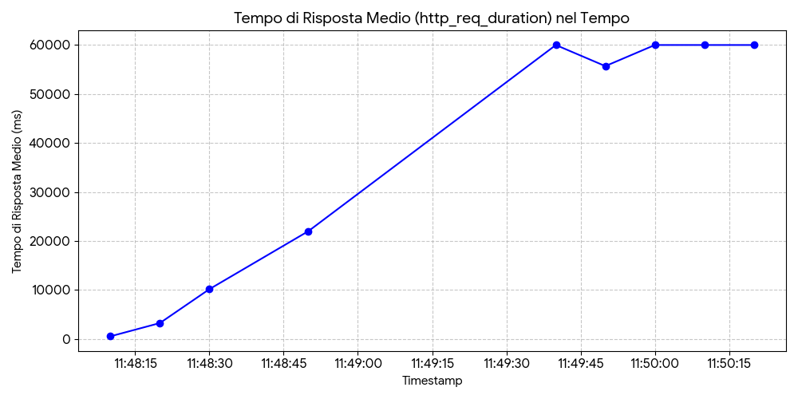
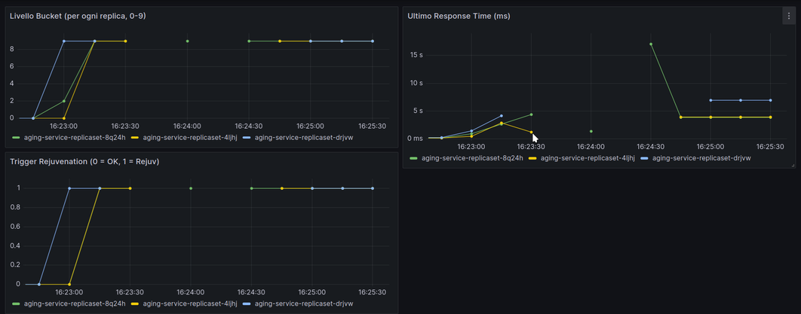

## Perché Linux Kubuntu

Obiettivo: eliminare il bottleneck di Windows per questo scenario: la virtualizzazione.

Docker e Minikube non devono più girare necessariamente in una macchina virtuale (es. WSL) che prealloca e consuma gb di memoria anche quando i container sono a riposo. Qui i container condividono direttamente il kernel Linux del sistema operativo host (non ci sono livelli intermedi aggiuntivi).

- Questo porta a un risparmio soprattutto in RAM, che è vitale soprattutto in computer con caratteristiche come le mie (niccoboa PC, con 5.7GB di RAM utilizzabili). Kubuntu con KDE Plasma su Wayland occupa ~1.2GB a riposo.

- Inoltre, tempi di build per l'immagine Docker e la compilazione del progetto più veloci (`minikube image build`, `./mvnw package`)

- Per evitare errori e blocchi Out-Of-Memory conviene avviare il cluster con valori ad hoc (es. usando il flag `--memory=2560 --cpus=2` nel comando di avvio) e regolare di conseguenza anche i limiti nel `replicaset.yaml` (es. con request moderate come `128Mi, limits: 256Mi`)
  
  

## Operazioni preliminari

### (0) Clonare il repository

Recupero codice sorgente da GitHub e posizionamento su branch di riferimento.

Consiglio: spostarsi nella cartella utente principale con `cd ~` o `cd ~/aging-service` (per installare git `sudo apt install git -y`)

```bash
sudo apt update
sudo apt install git -y
git clone https://github.com/niccoboa/aging-service.git
cd aging-service
git checkout nome-branch
```

- Verifica con `git branch`: appare un asterisco accanto a nome-branch selezionato

- Verifica con `pwd`: deve mostrare percorso simile a `/home/nome-utente/aging-service` (e non `/root/...`)

## (1) Installazione programmi utili e dipendenze

### VSCodium (consigliato)

Utilizzando pacchetto snap (`sudo apt install snapd`)

```bash
sudo snap install codium --classic 
```

Altrimenti con `apt install`, dopo aver raggiunto la repo ufficiale

```bash
wget -qO- https://gitlab.com/paulcarroty/vscodium-deb-rpm-repo/raw/master/pub.gpg \
  | gpg --dearmor \
  | sudo tee /usr/share/keyrings/vscodium-archive-keyring.gpg >/dev/null
echo 'deb [arch=amd64,arm64 signed-by=/usr/share/keyrings/vscodium-archive-keyring.gpg] https://download.vscodium.com/debs vscodium main' \
  | sudo tee /etc/apt/sources.list.d/vscodium.list
sudo apt update
sudo apt install codium
```

### JDK 21

```bash
sudo apt install openjdk-21-jdk -y
```

### Docker

Il comando `sudo usermod -aG docker $USER` aggiunge l'utente "in cui ci troviamo" al gruppo Docker. Assicurarsi di lanciare il comando quando siamo posizionato nel nostro "utente normale"

- Ergo, se siamo nella sessione `/root` uscire, in quanto all'interno di questa cartella risulta scomodo la modifica dei file con gli editor. Per uscire basta usare `exit`

- Insomma, lanciare quel comando quando ci troviamo nell'utente standard e non nella root (quindi non in `root@nome-pc` ma assicurarsi di trovarci in `nome-utente@nome-pc`)

```bash
sudo apt install docker.io -y
sudo usermod -aG docker $USER
newgrp docker
```

Verifica con `docker ps`. Viene restituita lista (vuota) dei container senza errori

### Minikube e kubectl

```bash
sudo snap install kubectl --classic
curl -LO https://storage.googleapis.com/minikube/releases/latest/minikube-linux-amd64
sudo install minikube-linux-amd64 /usr/local/bin/minikube
```

Per avviarlo (vedi dopo), si usa `minikube start` con attributi personalizzati (es. `--memory=2560 --cpus=2`)

- Quindi, si verifica con `kubectl get nodes`. Il nodo `minikube` appare in stato `Ready`

### k6

```bash
sudo gpg -k
sudo gpg --no-default-keyring --keyring /usr/share/keyrings/k6-archive-keyring.gpg --keyserver hkp://keyserver.ubuntu.com:80 --recv-keys C5AD17C747E3415A3642D57D77C6C491D6AC1D69
echo "deb [signed-by=/usr/share/keyrings/k6-archive-keyring.gpg] https://dl.k6.io/deb stable main" | sudo tee /etc/apt/sources.list.d/k6.list
sudo apt install k6 -y
```

Verifica con `k6 version`

## Step per replicare simulazione

### FASE 0: Setup ambiente

1. Avvio di minikube con limiti di risorse espliciti
   
   ```bash
   minikube start --memory=2560 --cpus=2
   ```
   
   - Verifica con `kubectl get nodes`. Mostrerà nodo `minikube` in stato `Ready`

2. Build immagine e Deploy
   
   ```bash
   eval $(minikube docker-env)
   ./mvnw package -DskipTests
   minikube image build -t aging-service:1.0.1 -f src/main/docker/Dockerfile.jvm .
   kubectl apply -f replicaset.yaml
   ```
   
   - Verifica con `kubectl get pods`. Mostrerà i pod `aging-service` in stato "Running" 
     - Un modo invece di *eliminare* eventuali pod sarebbe `kubectl delete pods -l app=aging-service`
   - NB: Specificare la versione `aging-service` dichiarata nel file YAML (nell'esempio qui sopra la `1.0.1` che lancia 3 pods)
   - Ho usato `DskipTests` per forzare la generazione dell'eseguibile (ToDo: spiega meglio perché). L'output dopo questo comando dovrebbe essere ``[INFO] BUILD SUCCESS`.

3. Esponi il servizio (in un altro terminale)
   
   ```bash
   kubectl port-forward svc/aging-service-lb 8080:8080
   ```
   
   - Il comando rimane in esecuzione e stampa messaggi di forwarding per la porta 8080

---

### FASE 1: Generare un carico realistico MMPP e studiare l'aging

1. Usage Test con k6 (nel terminale precedente, o in uno ancora nuovo), esecuzione del carico
   
   ```bash
   k6 run load-test.js --out csv=results_mmpp.csv
   ```
- Il test genera il traffico secondo il modello MMPP (*Markov Modulated Poisson Process*) e durerà qualche minuto. Viene in particolare generato un carico MMPP in modalità "over-time" con arrivi asincroni
  - I dati vengono anche registrati in un file csv
  - Questo test vuole valutare come variano i tempi di risposta al variare del carico. Questo è utile per la fase successiva perché ci aiuta a calibrare le soglie dei buckets
  - l'executor `constant-arrival-rate`



- Il test evidenzia l'invecchiamento software (*aging*), in quanto il tempo di risposta medio globale parte da un valore basso (replica fresca, circa ~400ms) e poi cresce raggiungendo il limite imposto dal timeout di 60000ms   
  
  - Il carico variabile (con le fasi LOW, MID, HIGH) sta portando alla saturazione del server

> Conclusione fase 1: il sistema degrada sotto carico
> 
> Prossime fasi: estrarre le metriche (response time) delle singole repliche per gestire i futuri buckets

## 

## FASE 2: Infrastruttura di monitoraggio

1. Ricavare le metriche della singola replica. Invece di interrogare direttamente l'ID della replica (poco scalabile) si utilizza Prometheus (eventualmente abbinato a Istio), uno strumento ad hoc per l'osservabilità delle risorse, è il metric server ufficiale di Kubernetes
   
   ```bash
   kubectl apply -f prometheus.yaml
   ```
- Verifica con `kubectl get pods -n monitoring`, appare pod Prometheus in stato di Running

- A noi ci interessa ricavare un response time che sia riconducibile alla singola replica (ogni replica ha il proprio ID) per poter poi gestire il bucket di quello specifico pod

N.B. Istio è un service mesh che inietta un proxy (Envoy) in ogni singolo pod e richiede un control plane (`istiod`) sempre attivo che potrebbe causare problemi (es. Out-Of-Memory) su cluster Minikube a cui abbiamo assegnato poche risorse (es. 2 GB di RAM). Allora, invece di affidarsi a un ente esterno, proviamo a calcolare il tempo di risposta e quindi poi a implementare il bucket system in modo diretto, cioè direttamente dentro il codice Java di Quarkus. Per farlo, dobbiamo trovare un modo per calcolare "internamente" all'applicazione il response time:

- Utilizziamo un timer (`t_end - t_start`) attorno al metodo `compute()` per avere il tempo esatto *per una singola richiesta su una singola replica*

- Valutiamo se quel tempo ha superato la soglia ($\mu + m\sigma$) e aggiorniamo variabile (token $\pm$1)

- Con l'estensione Micrometer di Quarkus il microservizio riesce a esporre all'endpoint `/q/metrics` sia il tempo di risposta sia il *livello attuale* dei bucket. Prometheus "passerà" a controllorare ogni tot secondi (es. 5 secondi), leggendo i dati per mostrarli su Graphana


2. Per abilitare l'esposizione delle metriche verso Prometheus, aggiungiamo le dipendenze necessarie dentro il file `pom.xml` nel blocco `<dependencies>`:
   
   ```xml
   <dependency>
       <groupId>io.quarkus</groupId>
       <artifactId>quarkus-micrometer</artifactId>
   </dependency>
   <dependency>
       <groupId>io.quarkus</groupId>
       <artifactId>quarkus-micrometer-registry-prometheus</artifactId>
   </dependency>
   ```
   
   Queste estensioni dicono a Quarkus di attivare il framework Micrometer e di creare in automatico un endpoint (`http://localhost:8080/q/metrics`) in un formato che Prometheus riesce a leggere nativamente.  
   
   N.B. Una volta inserite le dipendenze, eseguire nuovamente `./mvnw package -DskipTests` per ricompilare il progettodi nuovo
   
   

### FASE 3: Codice Java per logica dei buckets

Modifica del file `AgingResource.java` e ricompilazione del progetto


### FASE 4: Graphana

Intanto, si modifica Prometheus affinché risolva tramite DNS interno di Kubernetes gli IP di tutti e 3 i pod dietro il Service e si aggiunge blocchi necessari per configurare Graphana nel file `grafana.yaml`

```yaml
resources:
          requests:
            cpu: "100m"
            memory: "128Mi"
          limits:
            cpu: "300m"
            memory: "256Mi"
```

Quindi

```bash
kubectl apply -f prometheus.yaml
kubectl apply -f grafana.yaml
```

Si espongono le interfacce 

```bash
kubectl port-forward svc/prometheus-service 9090:9090 &
kubectl port-forward svc/grafana-service 3000:3000 &
```

Una volta verificati i 3 target attivi su Prometheus, potrai accedere a Grafana (`http://localhost:3000`, credenziali default `admin` / `admin`), aggiungere `http://prometheus-service:9090` come Data Source e creare un grafico con la query `aging_bucket_level` per vedere le 3 curve dei pod salire in tempo reale mentre lanci k6


Andiamo quindi a creare una Dashboard con 3 pannelli

Primo pannello

- Nel menu laterale sinistro di Grafana, vai su **Dashboards** (icona con i quattro quadratini) → clicca su **New** → **New Dashboard** → **+ Add visualization** (scegli `prometheus` se richiesto).

- Nella sezione **Metrics** in basso, passa alla modalità **Code** (in alto a destra del box query) e incolla: `aging_bucket_level`.

- Sotto **Options** (espandi la riga sotto la query), imposta **Legend** su `Custom` e scrivi `{{pod}}` per distinguere le 3 repliche.

- Nel pannello di destra, imposta **Title** su `Livello Bucket per Replica (0 - 9)`

- Clicca su **Apply** in alto a destra.

- Verifica: Appare un grafico a linee con 3 serie distinte corrispondenti ai nomi dei 3 pod.


Secondo pannello:

- Nella barra superiore della dashboard, clicca sull'icona **Add** (il grafico con il `+`) → **Visualization**.

- Inserisci query: `aging_last_response_time_ms`

- Imposta **Legend** su `{{pod}}` e **Title** (a destra) su `Ultimo Response Time (ms)`.

- Sotto **Unit** (nel menu a destra, sezione *Standard options*), seleziona `Time` → `milliseconds (ms)`.

- Clicca su **Apply** in alto a destra.

- *Verification:* Nella dashboard compaiono due pannelli affiancati o sovrapposti.
  
  

Terzo pannello:

- Clicca nuovamente su **Add** → **Visualization** e inserisci la query:

- Query: `aging_rejuvenation_triggered`

- Imposta **Legend** su `{{pod}}` e **Title** su `Trigger Rejuvenation (0 = OK, 1 = Rejuv)`.

- Clicca su **Apply**, poi sull'icona **Save dashboard** (il dischetto in alto a destra) e assegnale un nome (es. `SW Aging - Bucket System`).

- *Verification:* La dashboard è salvata; imposta in alto a destra il range temporale su **Last 5 minutes** e il refresh automatico su **5s** (cliccando sulla freccetta accanto all'icona di ricarica).


**Lancia il test k6 per popolare i grafici:**

Ora che la dashboard è in ascolto ogni 5 secondi, torna nel terminale nella cartella `~/aging-service` (assicurandoti che `kubectl port-forward svc/aging-service-lb 8080:8080` sia attivo) e avvia lo script di carico MMPP:

```
k6 run load-test.js --out csv=results_bucket.csv
```

*Verification:* Osservando Grafana, vedrai le linee dei 3 pod salire a gradini (`aging_bucket_level`) man mano che i tempi di risposta superano le soglie $\mu + m\sigma$.


Per vedere tutte e 3 le repliche popolarsi e osservare la "scaletta" dei bucket salire e scendere in tempo reale, esegui questi passaggi:

- In alto a destra nella schermata di Grafana, clicca sul selettore dell'intervallo temporale (attualmente su *Last 6 hours*) e impostalo su **Last 5 minutes**. Imposta anche l'aggiornamento automatico su **5s** cliccando sulla freccetta accanto all'icona di refresh.

- Verifica che sia attivo `kubectl port-forward svc/aging-service-lb 8080:8080`

- Lancia il test di carico `k6 run load-test.js --out csv=results_bucket.csv`


